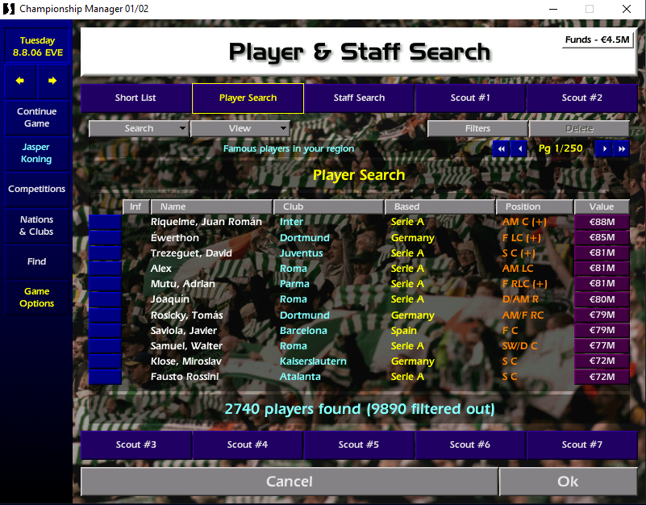

# Two-footed marker in CM01/02 player search

Version 0.1 beta, 5 November 2026.

Adds ` (+)` after a player's positions in the Player & Staff Search positions view when the player is classified as **Either** in the original player profile.

Example: `AM/F LC (+)`.

**[Download v0.1-beta](https://github.com/jasperkoningnl/cm0102-two-footed-search/releases/tag/v0.1-beta)**

This is a display change. It does not change player attributes, transfers, match calculations, sorting or saved-game data. It does not add a foot filter. Other search views and other screens are not changed.

## Install with Nick's Patcher

1. Close CM01/02. Make a backup of the game executable you actually launch.
2. Extract this ZIP. Drag that executable onto **CheckCompatibility.cmd**. Continue only if it says **PASS**. The checker only reads files; it does not install anything. **ALREADY INSTALLED** means no installation is needed.
3. Open [Nick's CM0102Patcher](https://github.com/nckstwrt/CM0102Patcher/releases) and select the same executable.
4. Choose **Tools > Apply Patchfile** and select **TwoFootedSearch.patch**.
5. Start the game normally, load your save and open a player search view that shows positions. Compare a marked player with the preferred foot on his profile.

This is a separate external patch file, not an official built-in Nick's Patcher option. The game executable must already have the expanded 3.9.68 layout used by Nick's Patcher. The patch deliberately does not rebuild executable headers, which could interfere with other custom sections. If the checker does not pass, do not apply this beta; report the result instead.

Nick's external patch applier writes bytes without enforcing the original-byte values in a patch file. That is why the separate compatibility check is included.

## Remove

With the game closed, restore your executable backup. Alternatively, if this beta is still installed and no later patch has changed its locations, select the same executable in Nick's Patcher and apply **RemoveTwoFootedSearch.patch** through **Tools > Apply Patchfile**. This removes the marker without removing unrelated patches. No save conversion is needed.

## Testing and limitations

- Both the initial `LR` variant and the current ` (+)` version have been confirmed working in-game in an 800x600 Cesena career. The screenshot above shows the current marker. Wider compatibility testing is still needed.
- The current assembly passed 8,820 emulated cases covering foot values, null input, text capacity, output boundaries and register/stack preservation, with the original position formatter represented by a stub.
- Applying and removing the public patch files reproduced the expected executable bytes exactly in local checks. The actual Nick's Patcher UI installation flow has been checked against its source, not exercised visually.
- The compatibility checker verifies the relevant layout and patch bytes. It cannot guarantee compatibility with every other mod or future patch.
- Other resolutions, languages, executable bundles and databases have not been broadly tested. Long position strings may have less room for the marker.
- This beta requires the original preferred-foot interpretation: LeftFoot >= 15 and RightFoot >= 14. It follows that game's profile classification, rather than introducing a new definition of two-footedness.

When reporting results, include your executable/patch combination, resolution, game language and a screenshot showing the marker. Please do not upload a save or game executable just to report a display issue.

## Included files

- TwoFootedSearch.patch: install via Nick's Patcher.
- RemoveTwoFootedSearch.patch: remove this beta.
- CheckCompatibility.cmd and CheckCompatibility.ps1: read-only preflight check.
- TwoFootedSearch.asm: source of the new display hook.

No game executable, database, save, Nick's Patcher distribution or private local configuration is included.

## Development details

The patch redirects the original cdecl call at VA 0x0080DBEB (file offset 0x0040DBEB) to a 93-byte wrapper at VA 0x00FE6000 (file offset 0x008DB000). The wrapper calls the original positions formatter at 0x0053EE50 with its original arguments, then appends the marker when the player's foot values and output capacity allow it. The target memory is inside the already expanded executable section and must be unused before installation.

Developed with Codex, using Nick's Patcher's external patch format. This package is independent of Nick's Patcher and has not been reviewed or endorsed by its maintainer. Feedback and improvements are welcome.
